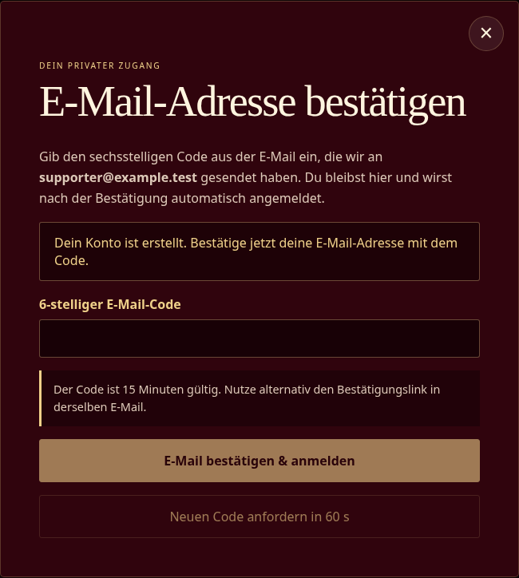
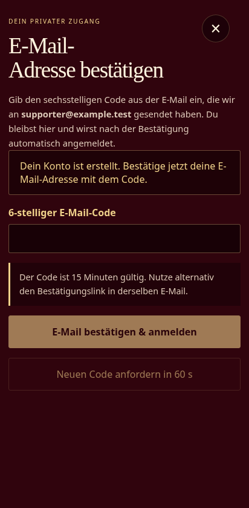
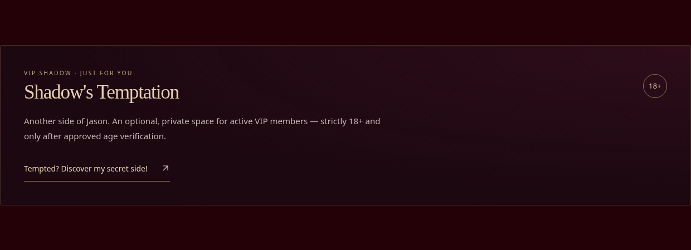

# Jason Shadow · Exclusive Membership — design review

The redesigned membership stays at https://exclusive.jason-shadow.com/.
These screenshots use a local build and synthetic member data. They are review
artifacts, not evidence of a production deployment.

## Supporter, registration and VIP update — published

The current change presents membership as support for Jason's music and voice
services for private celebrations and corporate events. The catalog contains
two clear Basic benefits, three Premium benefits and six VIP benefits:
shared preparation/craft insights and member conversation in every tier;
15% off all services for Premium/VIP; WhatsApp, meet-ups by arrangement and the
optional age-controlled private area for VIP. Duplicate gallery/update perks,
topic votes and priority-reply promises have been retired. Prices and terms of
existing purchases are not rewritten by the catalog migration.

The exact VIP teaser is **Psst... Discover Shadow's Temptation 😏**. This name
is a private-area sub-brand only. The website, music newsletter and account
emails remain Jason Shadow / Order of Shadows. New checkout acceptance and
catalog cache URLs use `ORDER-2026-10-30-V4`.

Registration now keeps the dialog open for a six-digit email code. The same
email contains a single-use fallback link to the homepage. Successful
verification creates a fresh session and shows a localized confirmation popup;
existing MFA remains required where applicable. The optional VIP section sits
below the music gallery and retains the existing server-side access controls.

The separate owner-requested D1 cleanup succeeded in
[run 41063101385](https://github.com/JasonWinckler/ExclusiveWebsite/actions/runs/41063101385)
from exact revision `8a8d73dc130aa03bdbc11bca71762bfc34ac2ae6`: one ADMIN
profile/identity and one active post with all three attachment-history records
remain; old privacy/billing/customer records and two retired posts were removed.
Credentials, MFA, sessions, devices and the retained post/catalog were preserved
exactly inside the atomic transaction. See the
[operation evidence](../../cloudflare/operations/README.md) for scope and guards.
The website/authentication update was published successfully in
[run 41063340618](https://github.com/JasonWinckler/ExclusiveWebsite/actions/runs/41063340618)
from exact revision `6cbdcbec59f9227037f9d03622cc8244e2755f8c` on 2026-10-30.
Migrations 0030/0031, all five Workers and the existing Pages project were
deployed. The rollout verified the exact canonical commit/assets, service
health and both frontend catalog URLs before resuming newsletter delivery.

Independent live checks confirmed 2/3/6 perks in both languages, no duplicates,
the exact VIP teaser, API health and byte-identical frontend assets
`index-B7Nn_Fxs.js` / `index-BHOTTJpK.css`. Anonymous code confirmation and
private-content requests returned 401; no account was created or email sent.
These checks do not establish inbox delivery; all email-transport tests used
synthetic recipients and mocks.

## Website

## Registration and optional VIP access

The current supporter copy describes music and voice services for private
celebrations and corporate events. The registration dialog stays open for a
six-digit email code; a confirmation link remains available in the same email.
These previews use a synthetic `example.test` account and do not send mail.

The private VIP section appears below the music gallery with an explicit 18+
marker. The teaser opens age verification; approved, authorized VIP members see
the private gallery inline. No private content is loaded before authorization.

For this supporter/code-verification update, the final frontend build passed
with main JavaScript at 365,935 / 450,000 bytes and main CSS at
117,547 / 120,000 bytes. All 98 desktop/mobile Playwright checks passed locally,
including code confirmation, fallback links, invalid/expired challenges,
resend cooldown, MFA, tier benefits, protected access and narrow layouts.
The homepage and email-code previews above were regenerated from that build.
These checks use synthetic API responses; they do not establish live inbox
delivery or constitute a production deployment.

## Member dashboard

These earlier dashboard illustrations show the shared music content and the
selected membership's benefits. The current VIP placement is shown separately
above; the private area is optional and remains age-controlled.

## Newsletter

This is illustrative newsletter content rendered with the production email template.
No real test email or newsletter was sent for this review.

## Current local verification

- The production frontend build and existing bundle budgets pass; exact sizes
  and all 98 desktop/mobile browser checks are recorded above.
- The focused benefits/access run passes 25 tests across three files. The new
  migration tests preserve seeded accounts, content, comments, orders, invoices,
  entitlements and earlier acceptance snapshots; validate both languages and
  the 2/3/6 benefit counts; and retain retired catalog rows without reactivation.
- Full backend TypeScript validation and 202 tests across 25 files passed,
  including real SQLite verification races, session-write rollback and bounded
  email-change delivery routing. All 27 rollout guard tests also passed. The
  earlier 173/24/70 test counts below belong to the previous release.
- All 11 isolated cleanup tests passed, including preservation, rollback,
  schema/inventory changes, dependencies and one-time execution.
- Original logo and owned artist photographs were copied from the music website.

No production deployment, production migration, owner-role repair or real mail
send is claimed by these local checks. Live email delivery and authenticated
membership/payment behavior still need controlled production verification.
The [transition guide](../ORDER_OF_SHADOWS_TRANSITION.md) documents the guarded
production workflow and release checks.

## Production history — 2026-10-30, migrations 0027/0028

The independent owner operation [succeeded in production](https://github.com/JasonWinckler/ExclusiveWebsite/actions/runs/41046845875):
the existing `business@jason-shadow.com` account has ADMIN access with MFA
required. Previous sessions were revoked; password/MFA credentials and profile
data were preserved. The owner must sign in again.

The updated API token passed the [read-only production inspection](https://github.com/JasonWinckler/ExclusiveWebsite/actions/runs/41046781892).
The coordinated [production rollout succeeded](https://github.com/JasonWinckler/ExclusiveWebsite/actions/runs/41050723595)
at reviewed revision `ea3a904ceb09055e9c47eb45b36103191c1df012`:

- Newsletter maintenance was paused and drained before recording a D1 recovery
  bookmark and applying migrations 0027/0028.
- All five Workers and the existing Pages project were deployed. The canonical
  Pages commit and frontend asset hashes matched the reviewed release.
- Public API health/service bindings, Basic/Premium/VIP Shadow names, both 15%
  service discounts and removal of the VIP Telegram benefit passed live checks.
  A separate anonymous request to private VIP content returned HTTP 401.
- Ordinary opted-in newsletter delivery was resumed after verification. No
  test email, payment, private media publication or customer impersonation occurred.

The workflow uses `CLOUDFLARE_API_TOKEN`; the global API key is not used. Worker
configurations preserve existing operational variables during both scripted and
automatic Cloudflare deployments; explicit configuration still takes precedence.

At that release, both external destinations remained behind the former shared
review gate. The owner has since approved WhatsApp for music and clarified that
Telegram is an adult-content destination, outside every music membership.
The follow-up source correction is described below; the earlier release record
does not establish that this correction is live.

## WhatsApp/Telegram correction — verified production release

Current source removes Telegram benefits from all music tiers and introduces
migration `0029_remove_telegram_music_perks.sql`. The destinations have separate
configuration: `VIP_WHATSAPP_MUSIC_REVIEWED=true` for the approved VIP music
contact and `MUSIC_TELEGRAM_REVIEWED=false` for Telegram. The former shared flag
is unused. Historical Telegram records and their cleanup/revocation controls
remain; no adult Telegram routing is added. New checkout terms use
`ORDER-2026-10-30-V3`, preserving earlier acceptance snapshots. Privacy remains V2.

Backend typechecking and all 173 tests in 23 files pass for this correction,
as do all 24 focused rollout guard and diagnostic tests and 70 desktop/mobile
browser checks. Production build and bundle budgets pass.
Migration 0029 and the independent contact gates were deployed in
[run 41053535266](https://github.com/JasonWinckler/ExclusiveWebsite/actions/runs/41053535266).
The final [revision-aware catalog release](https://github.com/JasonWinckler/ExclusiveWebsite/actions/runs/41054899735)
verified commit `2ce61a15cd1bbc4b266e0c299beb85d74f2dd77b`, all service bindings,
both normal German/English frontend catalog URLs and the canonical Pages
revision/assets. Existing catalog caches are isolated by offer revision, and
the browser uses the same revision for checkout terms and catalog requests.

Production metadata checks confirmed WhatsApp music approval enabled, Telegram
music approval disabled and the private WhatsApp number present as a secret
binding. The number itself was not read or disclosed. Separate public checks
confirmed zero Telegram benefits in DE and EN, including previously cached
unversioned catalog URLs. Newsletter delivery resumed after verification.
No authenticated member impersonation, external contact message or Telegram
membership modification was performed by the release process. The screenshots
above use synthetic accounts and remain local design evidence.

## Affiliate program

The central affiliate page is `https://jason-shadow.com/affiliates`. The member
site, localized landing pages and link hub link there. The former `/affiliates`,
`/affiliates/` and `/affiliates/index.html` routes have exact permanent 301 rules
in `public/_redirects`; the unused local affiliate stylesheet was removed.
No local affiliate page or sitemap entry is retained.

The final build includes these redirect rules and excludes the old stylesheet.
A local Pages runtime check verified all three destinations and the unchanged
SPA fallback. Ten affected desktop/mobile browser checks and twelve direct
footer-link/label checks passed without visiting the external affiliate page or
submitting a form.

Archived adult posts still require individual administrator publication, and
earlier newsletter consent requires a new music opt-in. Actual mailbox delivery
and provider/cached sender names have not been verified by sending a test message.
