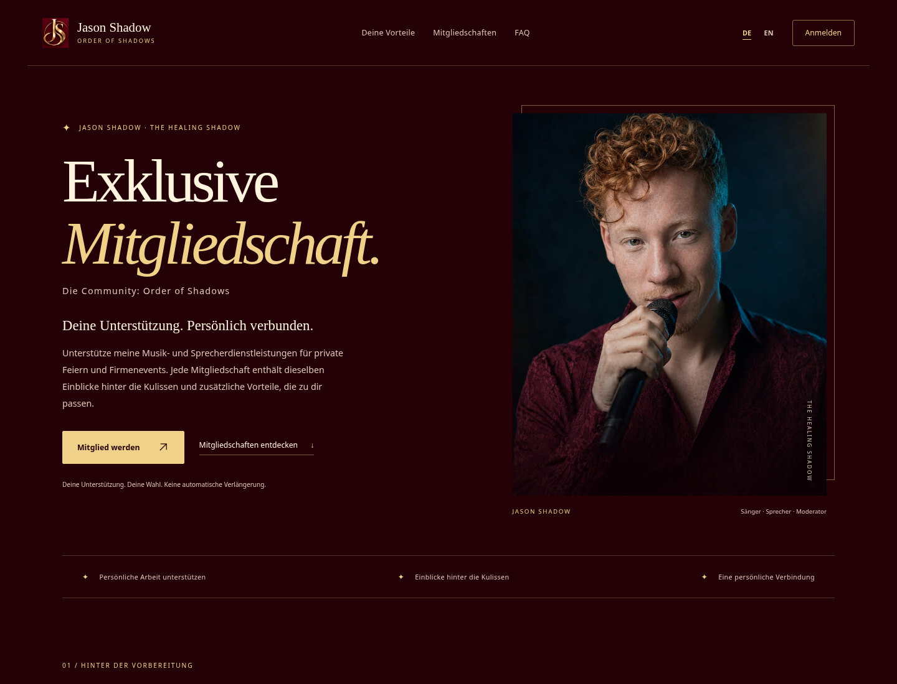
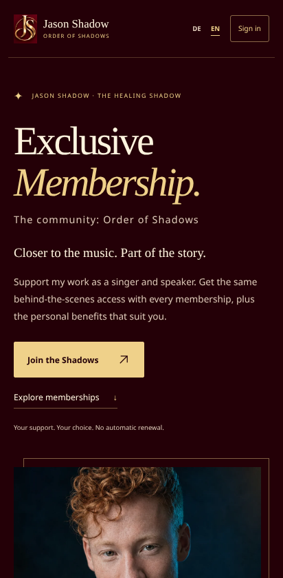
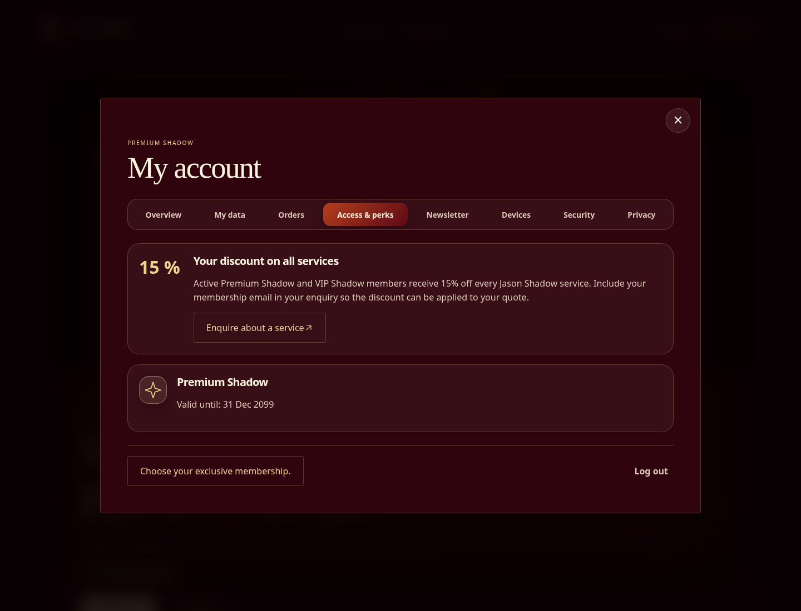
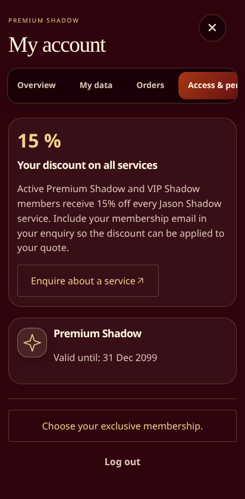
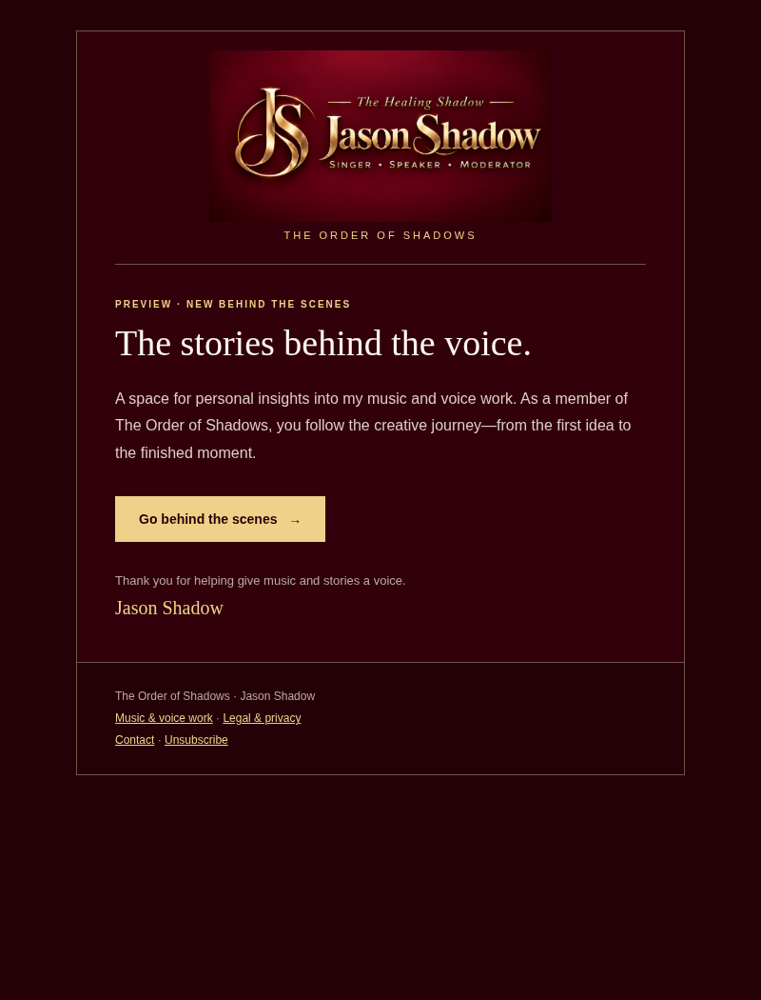

# Jason Shadow · Exclusive Membership — design review

The redesigned membership stays at https://exclusive.jason-shadow.com/.
These screenshots use a local build and synthetic member data. They are review
artifacts, not evidence of a production deployment.

## Website

## Member dashboard

The dashboard presents the shared music content and the selected membership’s
benefits. The separate private VIP area is optional and remains age-controlled.

## Newsletter

This is illustrative newsletter content rendered with the production email template.
No real test email or newsletter was sent for this review.

## Verification of the 0027/0028 release

- Production frontend build and existing bundle budgets pass.
- Backend TypeScript checks and all 171 tests in 22 files pass, including
  migration preservation, content separation, newsletter consent, owner-role
  repair guards and maintenance compatibility during migration.
- All 21 rollout guard and diagnostic tests pass.
- All 70 Playwright checks pass on desktop and mobile with synthetic API fixtures,
  including the final layout and age-review refresh corrections.
- Original logo and owned artist photographs were copied from the music website.

No production deployment, production migration, owner-role repair or real mail
send is claimed by these local checks. Live email delivery and authenticated
membership/payment behavior still need controlled production verification.
The [transition guide](../ORDER_OF_SHADOWS_TRANSITION.md) documents the guarded
production workflow and release checks.

## Production history — 2026-10-30, migrations 0027/0028

The independent owner operation [succeeded in production](https://github.com/JasonWinckler/ExclusiveWebsite/actions/runs/41046845875):
the existing `business@jason-shadow.com` account has ADMIN access with MFA
required. Previous sessions were revoked; password/MFA credentials and profile
data were preserved. The owner must sign in again.

The updated API token passed the [read-only production inspection](https://github.com/JasonWinckler/ExclusiveWebsite/actions/runs/41046781892).
The coordinated [production rollout succeeded](https://github.com/JasonWinckler/ExclusiveWebsite/actions/runs/41050723595)
at reviewed revision `ea3a904ceb09055e9c47eb45b36103191c1df012`:

- Newsletter maintenance was paused and drained before recording a D1 recovery
  bookmark and applying migrations 0027/0028.
- All five Workers and the existing Pages project were deployed. The canonical
  Pages commit and frontend asset hashes matched the reviewed release.
- Public API health/service bindings, Basic/Premium/VIP Shadow names, both 15%
  service discounts and removal of the VIP Telegram benefit passed live checks.
  A separate anonymous request to private VIP content returned HTTP 401.
- Ordinary opted-in newsletter delivery was resumed after verification. No
  test email, payment, private media publication or customer impersonation occurred.

The workflow uses `CLOUDFLARE_API_TOKEN`; the global API key is not used. Worker
configurations preserve existing operational variables during both scripted and
automatic Cloudflare deployments; explicit configuration still takes precedence.

At that release, both external destinations remained behind the former shared
review gate. The owner has since approved WhatsApp for music and clarified that
Telegram is an adult-content destination, outside every music membership.
The follow-up source correction is described below; the earlier release record
does not establish that this correction is live.

## WhatsApp/Telegram correction — awaiting release evidence

Current source removes Telegram benefits from all music tiers and introduces
migration `0029_remove_telegram_music_perks.sql`. The destinations have separate
configuration: `VIP_WHATSAPP_MUSIC_REVIEWED=true` for the approved VIP music
contact and `MUSIC_TELEGRAM_REVIEWED=false` for Telegram. The former shared flag
is unused. Historical Telegram records and their cleanup/revocation controls
remain; no adult Telegram routing is added. New checkout terms use
`ORDER-2026-10-30-V3`, preserving earlier acceptance snapshots. Privacy remains V2.

Backend typechecking and all 171 tests in 22 files pass for this correction,
as do all 21 focused rollout guard and diagnostic tests and 70 desktop/mobile
browser checks. Production build and bundle budgets pass.
Production migration, updated Worker settings and frontend publication for this
follow-up have not yet been established by a recorded rollout. The screenshots
above reflect this correction using synthetic accounts and do not verify a
production release.

Archived adult posts still require individual administrator publication, and
earlier newsletter consent requires a new music opt-in. Actual mailbox delivery
and provider/cached sender names have not been verified by sending a test message.
